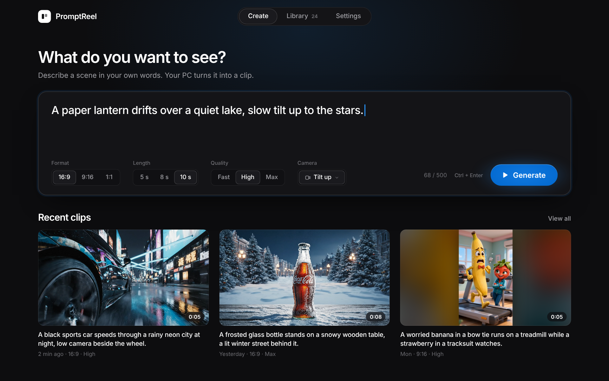
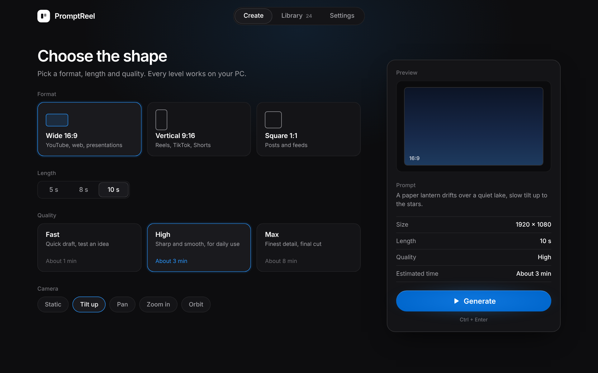
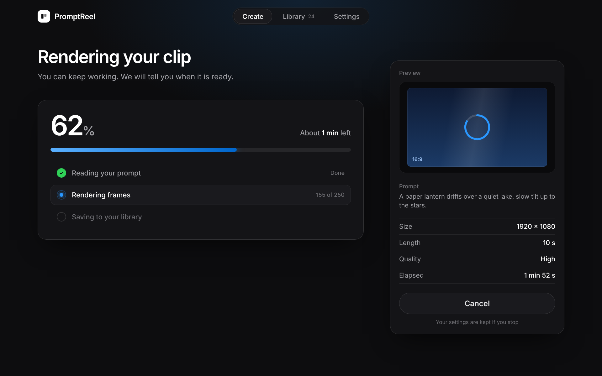
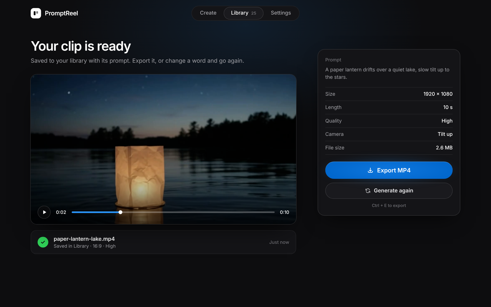

# PromptReel

**Type a scene. Get the footage.**

A free AI text-to-video app for Windows: one sentence in, one clip out, on your own PC. 
No credits. No subscription. No queue.

**English** · [中文](README.zh-CN.md)

## Free. Really.

No credits, no monthly plan, no monthly cap. You open the app, type a scene, and get a clip. Your PC does the work, so prompts and clips never leave your computer.

## How it works

1. **Describe the shot.** Write what happens and how the camera moves.
2. **Choose the shape.** Wide, vertical or square. Pick the length and quality.
3. **Press generate.** The clip renders in the background and you can keep working.
4. **Save and use.** Every clip is stored with its prompt. Export to MP4, or change a word and run it again.

## Inside the app

 
Pick the shape and the camera move, then keep working while it renders.

## Example

> A paper lantern drifts over a quiet lake, slow tilt up to the stars.

 
16:9 · 10 s · High · Camera: Tilt up · <a href="examples/lantern.mp4">full clip (mp4)</a>

The finished clip is saved with its prompt, ready to export or run again with a changed word:

More examples will be added to the [`examples`](examples) folder.

## Download

1. Get the `.zip` from the [latest release](https://github.com/silverdugongenhance/promptreel/releases/latest).
2. Unpack it and run the app.
3. On the first launch you need internet, to download the video model. After that it works offline.

Windows 10 or 11, 64-bit. macOS is in development.

<!-- Add real minimum specs here (RAM, free disk space, GPU). People look for this first. -->

## FAQ

**Is it really free?** Yes. It is in beta, so some things will change.

**Which model does it use?** [Wan 2.2](https://github.com/Wan-Video/Wan2.2), an open-source video model under the Apache 2.0 license.

**Can I use the clips commercially?** The model license allows it. Read the final terms in the app before you publish client work.

## Bugs and ideas

Open an [issue](https://github.com/silverdugongenhance/promptreel/issues). For a bug, please add your Windows version, your GPU and the prompt you used.

---

© 2026 PromptReel · Built on Wan 2.2

