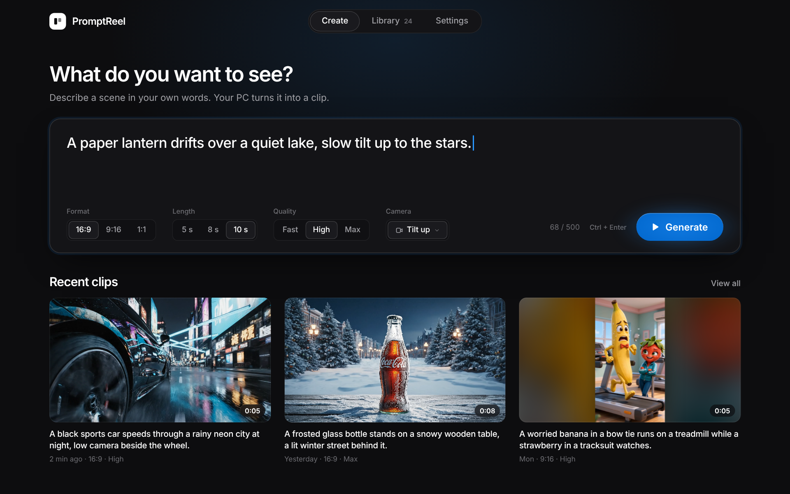
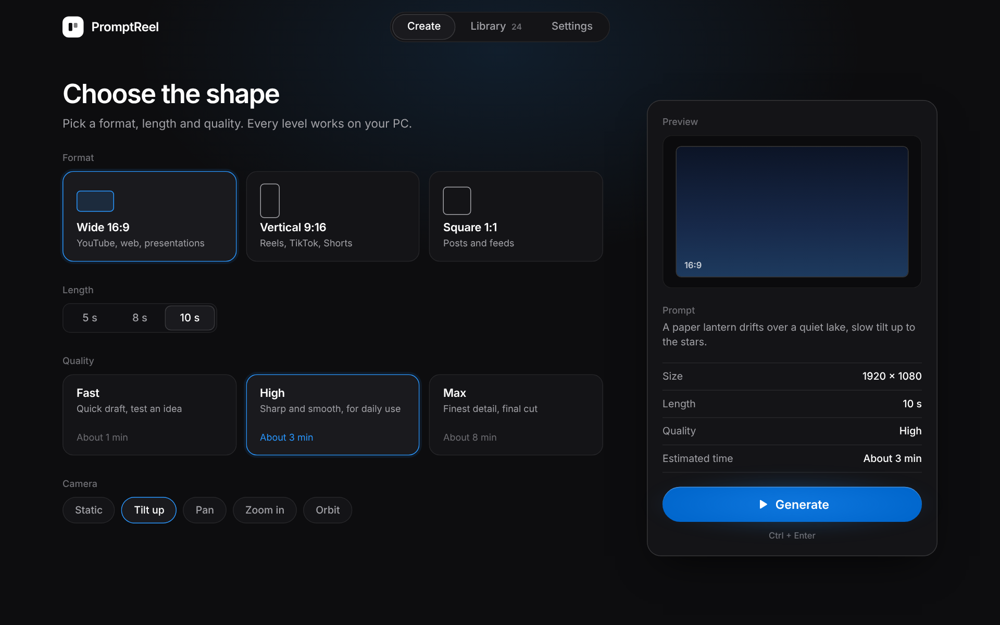
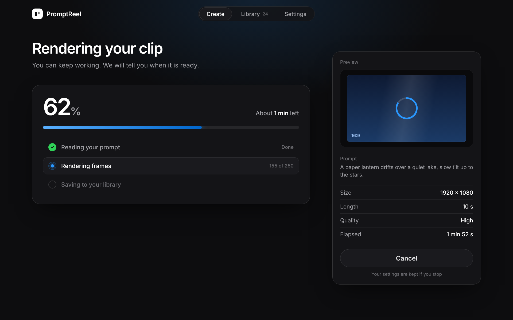
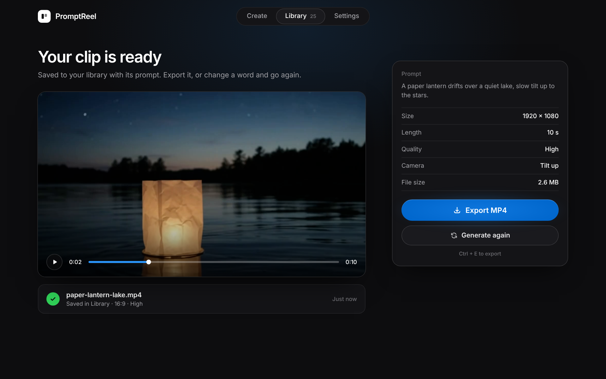

# PromptReel

**输入一个场景，得到一段视频。**

一款免费的 Windows AI 文字生成视频应用：输入一句话，得到一段视频，全程在你自己的电脑上完成。 
没有积分，没有订阅，无需排队。

[English](README.md) · **中文**

## 免费，就是真的免费

没有积分，没有月付套餐，也没有每月额度。打开软件，输入场景，就能得到视频。视频由你的电脑生成，提示词和成片都不会离开你的电脑。

## 怎么用

1. **描述镜头。** 写下发生了什么、镜头怎么动。
2. **选择画面。** 横屏、竖屏或方形，再设置时长和画质。
3. **点击生成。** 视频在后台渲染，你可以继续做别的事。
4. **保存并使用。** 每个片段都会连同提示词一起保存。导出 MP4，或者改一个词再生成一次。

## 界面

 
选好画幅和镜头运动，渲染在后台进行，你可以继续做别的事。

## 示例

> 一盏纸灯笼飘过宁静的湖面，镜头缓缓上摇至星空。

 
16:9 · 10 秒 · 高画质 · 镜头：上摇 · <a href="examples/lantern.mp4">完整视频（mp4）</a>

生成完成的视频会连同提示词一起保存，可以直接导出，也可以改一个词再生成：

## 下载

1. 从[最新发布](https://github.com/silverdugongenhance/promptreel/releases/latest)下载 `.zip` 压缩包。
2. 解压后运行软件。
3. 首次启动需要联网下载视频模型，之后可以离线使用。

支持 Windows 10 或 11（64 位）。macOS 版本正在开发中。

## 常见问题

**真的免费吗？** 是的。目前处于公测阶段，部分功能还会调整。

**使用的是哪个模型？** [Wan 2.2](https://github.com/Wan-Video/Wan2.2)，一个遵循 Apache 2.0 许可证的开源视频模型。

**生成的片段可以商用吗？** 模型许可证允许商用。发布客户项目之前，请先阅读软件内的最终条款。

## 问题和建议

欢迎提交 [issue](https://github.com/silverdugongenhance/promptreel/issues)。报告问题时，请附上 Windows 版本、显卡型号和使用的提示词。

---

© 2026 PromptReel · 基于 Wan 2.2 构建

